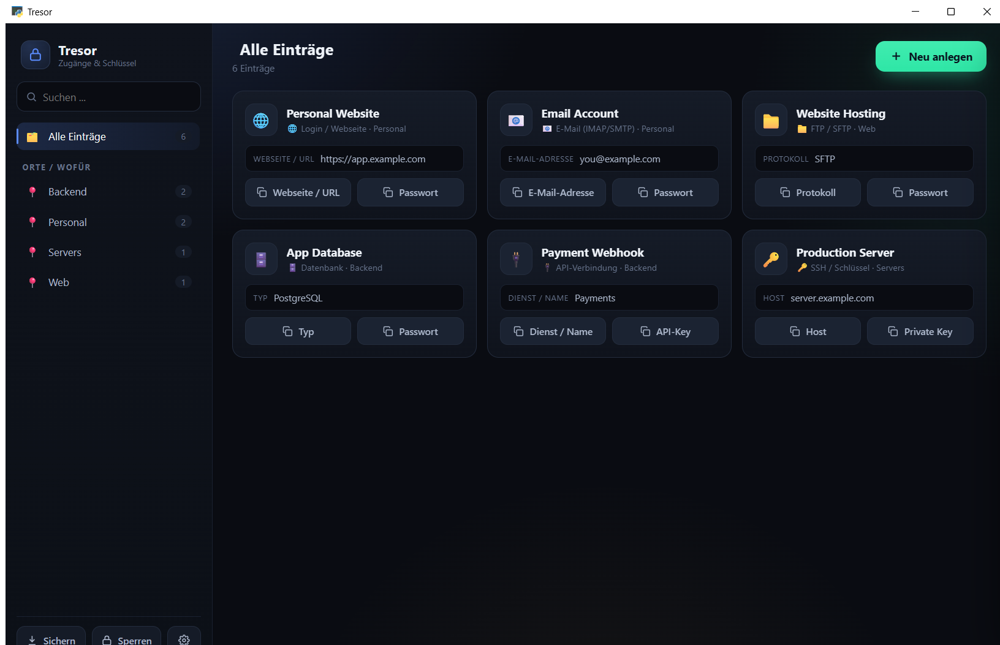

[Deutsch](README.md) · [English](README.en.md) · [Русский](README.ru.md)

# Tresor · Zugangsdaten bleiben auf deinem Windows-PC

Passwörter, Schlüssel und Verbindungsdaten in einer verschlüsselten lokalen Datei
verwalten — mit Suche, Zwischenablage und einem gesondert aufzubewahrenden Recovery-Key.

[](https://github.com/Juri-Halveth/halveth-tresor/actions/workflows/ci.yml)
[](CHANGELOG.md)

[**Windows-Release ansehen**](https://github.com/Juri-Halveth/halveth-tresor/releases) ·
[Technische Anleitung auf Englisch](README.en.md) · [Sicherheitsmodell](docs/security-model.md)



## Drei Dinge, die direkt helfen

- **Vollständige Zugänge:** Benutzername, Passwort, Host, Port, Schlüssel und weitere passende Felder zusammen speichern.
- **Schnell finden und kopieren:** Kategorien und Suche statt verstreuter Textdateien.
- **Lokale verschlüsselte Sicherung:** Eine Vault-Datei und einen getrennt aufzubewahrenden Recovery-Key erhalten.

## In einer Minute zum passenden Einstieg

1. Den [Windows-Release](https://github.com/Juri-Halveth/halveth-tresor/releases) öffnen und EXE sowie zugehörigen SHA-256-Wert ansehen.
2. Den Download prüfen: `Get-FileHash .\Tresor.exe -Algorithm SHA256`.
3. Beim ersten Start einen Test-Tresor anlegen und den Recovery-Key getrennt sichern.

Windows 10/11 x64 und WebView2 werden benötigt. Die veröffentlichten EXE-Dateien
sind derzeit **nicht code-signiert**. Ein passender Hash prüft die Übereinstimmung
mit dem veröffentlichten Paket; eine unabhängige Herstellerprüfung entsteht daraus nicht.

## Wie die Speicherung funktioniert

```text
Masterpasswort + PIN → Scrypt → Schlüssel zum Verpacken des Datenschlüssels
                                      │
Recovery-Key ─────── getrennte Route ──┤
                                      ↓
                           Datenschlüssel → AES-256-GCM → lokale Vault-Datei
```

Masterpasswort und PIN sind **zwei kombinierte lokale Wissensgeheimnisse**.
Die Kombination ist keine Zwei-Faktor-Authentisierung. Frische Nonces,
Headerbindung und atomisches Speichern sind im Quellcode und im
[Sicherheitsmodell](docs/security-model.md) dokumentiert.

Der Schutz bezieht sich auf die verschlüsselte Datei. Ein bereits kompromittierter
PC kann Eingaben und entsperrte Daten abgreifen. Ein unabhängiger externer Audit
steht aus; die datierten Projektprüfungen sind [hier](docs/review-status-2026-10-20.md) erreichbar.

## Aus dem Quellcode starten

```powershell
git clone https://github.com/Juri-Halveth/halveth-tresor.git
cd halveth-tresor
python -m pip install -e ".[dev]"
python -m tresor
pytest
python scripts/check_release.py
```

[Build und Architektur](README.en.md#build-from-source) ·
[Änderungen](CHANGELOG.md) · [Beiträge](CONTRIBUTING.md)

## Version und Rechte

Die kanonische Version steht in `src/tresor/__init__.py`. Python-Paket,
README-Badges und Windows-Versionsressource werden daran gebunden.
`scripts/check_release.py` stoppt Versionsdrift und einen abweichenden Release-Tag.
Die CI prüft zusätzlich die Versionsinformationen der tatsächlich gebauten EXE.

Historische MIT-Fassungen und neuere HALVETH-PIRL-Beiträge sind in der
[Lizenzkarte](LICENSES.md) nach Pfad und Version zugeordnet. Frühere Berechtigungen
und die [Drittanbieterhinweise](THIRD-PARTY-LICENSES.md) bleiben erhalten.

Zusammenarbeit: [juri@halveth.de](mailto:juri@halveth.de) ·
Sicherheitsmeldungen: [security@halveth.de](mailto:security@halveth.de)

Projektleitung: Juri / HALVETH · Entwicklung mit KI-Unterstützung.
